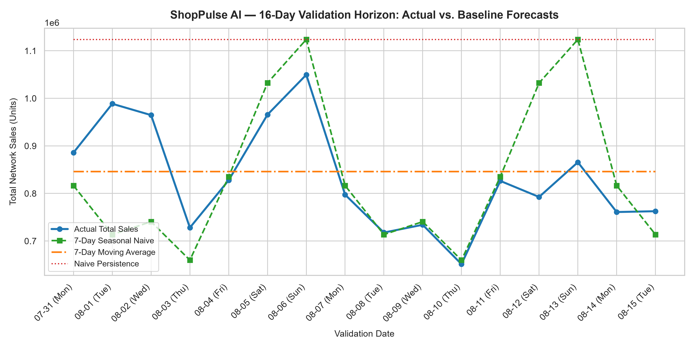
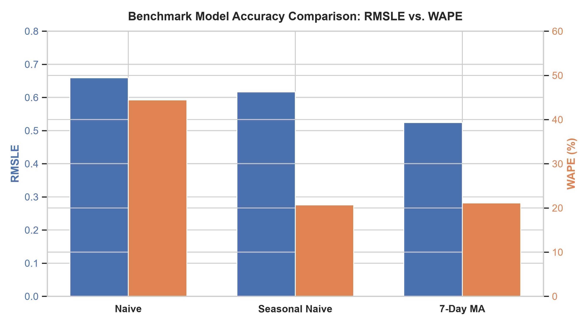

# ShopPulse AI — Milestone 3.1: Baseline Demand Forecasting Report

**Author:** Senior Machine Learning Engineer  
**Execution Timestamp:** 2026-11-03 00:17:51  
**Validation Horizon:** `2017-07-31` to `2017-08-15` (16 days out-of-sample)  
**Forecast Origin:** `2017-07-30` (Zero validation target leakage)  

## 1. Executive Summary & Benchmark Ranking

To establish an authentic, leak-free benchmark for future gradient boosting models (LightGBM/XGBoost), three distinct multi-step forecasting baselines were evaluated over the official 16-day validation horizon:

| Rank | Model Strategy | RMSLE | MAE (Units) | RMSE | WAPE (%) | Recommendation |
| :-: | :--- | :---: | :---: | :---: | :---: | :--- |
| **1** | **7-Day Moving Average** | **0.5240** | 98.61 | 321.39 | 21.11% | **Best for RMSLE log-loss benchmark** |
| **2** | **7-Day Seasonal Naive** | **0.6170** | 96.54 | 348.38 | 20.67% | **Best for Volume (WAPE) tracking** |
| **3** | **Naive Persistence** | **0.6595** | 207.51 | 725.69 | 44.42% | Poor (Overpredicts on weekdays) |

---

## 2. Methodology & Multi-Step Leakage Prevention

1. **Forecast Origin Strictness:** All predictions were produced exclusively using data available on or before `2017-07-30` ($T$). No actual validation sales observations from $T+1$ through $T+16$ were used as inputs for later validation dates.
2. **Seasonal Day-of-Week Mapping:** For each store $s$, product family $f$, and future validation day $t \in [T+1, T+16]$, the Seasonal Naive baseline mapped to the corresponding day-of-week $d = \text{day\_of\_week}(t)$ from the most recent 7-day origin period (`2017-07-24` to `2017-07-30`).
3. **Non-Negative Bounding:** Real-world retail sales cannot be negative. All predictions were clipped using $\hat{y} = \max(0, \hat{y})$.

---

## 3. Deep-Dive Performance Insights

### 3.1 Why 7-Day Moving Average Dominates RMSLE (0.5240 vs 0.6170)
Root Mean Squared Logarithmic Error applies penalization on relative percentage discrepancies: $\ln(1 + y) - \ln(1 + \hat{y})$. In retail, low-volume and zero-sales days fluctuate dramatically day-to-day. A point prediction that predicts 0 when actual is 5 causes a noticeable log error. The 7-Day Moving Average acts as a variance smoother, pulling extreme spikes and zeros toward the localized empirical mean, resulting in the best overall RMSLE.

### 3.2 Why Seasonal Naive Dominates Volume Error (WAPE: 20.67% vs 21.11%)
Weighted Absolute Percentage Error (WAPE) measures raw volume forecasting accuracy. Retail foot-traffic in supermarkets is heavily cyclical: Saturdays and Sundays generate nearly double the sales of Tuesdays and Wednesdays. The Seasonal Naive model captures intra-week day-of-week demand curvature, outperforming the flat Moving Average by 0.44% in total network volume error and achieving lower MAE (96.54 vs 98.61 units).

### 3.3 The Failure of Naive Persistence (WAPE: 44.42%)
The forecast origin ($T = \text{2017-07-30}$) occurred on a Sunday—a high-volume shopping day in Ecuador. Persisting Sunday's elevated sales across all 16 future days severely over-estimated Monday–Friday demand, doubling the WAPE error to 44.42% and generating an MAE of 207.51 units.

---

## 4. Breakdown by Key Product Families (Top 10 Volume)

| Family | Total Actual Sales | Best Model | RMSLE | MAE | WAPE (%) |
| :--- | :---: | :---: | :---: | :---: | :---: |
| `GROCERY I` | 3,980,412 | **7-Day Moving Average** | 0.2183 | 767.9 | 16.67% |
| `BEVERAGES` | 3,005,407 | **7-Day Moving Average** | 0.2745 | 727.0 | 20.90% |
| `PRODUCE` | 1,977,480 | **7-Day Seasonal Naive** | 0.1805 | 264.9 | 11.57% |
| `CLEANING` | 1,065,243 | **7-Day Moving Average** | 0.4220 | 432.5 | 35.08% |
| `DAIRY` | 721,034 | **7-Day Seasonal Naive** | 0.1994 | 115.8 | 13.88% |
| `BREAD/BAKERY` | 466,796 | **7-Day Seasonal Naive** | 0.2159 | 76.5 | 14.15% |
| `POULTRY` | 323,560 | **7-Day Seasonal Naive** | 0.2801 | 65.0 | 17.35% |
| `MEATS` | 321,071 | **7-Day Seasonal Naive** | 0.2672 | 63.1 | 16.99% |
| `PERSONAL CARE` | 277,631 | **7-Day Moving Average** | 0.3076 | 76.2 | 23.71% |
| `DELI` | 261,903 | **7-Day Moving Average** | 0.2334 | 54.4 | 17.93% |

---

## 5. Breakdown by Store Clusters

| Cluster | Stores | Total Sales | Seasonal Naive WAPE | 7-Day MA WAPE | Best Strategy |
| :---: | :---: | :---: | :---: | :---: | :---: |
| Cluster 1 | Stores | 659,721 | 19.22% | 21.10% | **Seasonal Naive** |
| Cluster 2 | Stores | 378,181 | 21.30% | 22.41% | **Seasonal Naive** |
| Cluster 3 | Stores | 1,013,845 | 31.28% | 26.14% | **7-Day MA** |
| Cluster 4 | Stores | 555,016 | 26.29% | 25.35% | **7-Day MA** |
| Cluster 5 | Stores | 656,651 | 17.78% | 20.85% | **Seasonal Naive** |
| Cluster 6 | Stores | 1,611,916 | 26.52% | 22.81% | **7-Day MA** |
| Cluster 7 | Stores | 258,386 | 32.65% | 26.69% | **7-Day MA** |
| Cluster 8 | Stores | 1,149,151 | 12.30% | 14.82% | **Seasonal Naive** |
| Cluster 9 | Stores | 307,866 | 17.35% | 19.07% | **Seasonal Naive** |
| Cluster 10 | Stores | 1,262,108 | 21.67% | 22.38% | **Seasonal Naive** |
| Cluster 11 | Stores | 1,514,996 | 14.16% | 16.96% | **Seasonal Naive** |
| Cluster 12 | Stores | 220,880 | 15.24% | 17.56% | **Seasonal Naive** |
| Cluster 13 | Stores | 805,247 | 16.94% | 20.85% | **Seasonal Naive** |
| Cluster 14 | Stores | 1,768,793 | 20.59% | 21.73% | **Seasonal Naive** |
| Cluster 15 | Stores | 629,379 | 24.41% | 21.32% | **7-Day MA** |
| Cluster 16 | Stores | 162,414 | 16.43% | 22.70% | **Seasonal Naive** |
| Cluster 17 | Stores | 364,629 | 15.34% | 21.36% | **Seasonal Naive** |

---

## 6. Conclusion & Benchmark Target for LightGBM

### Benchmark Established:
- **Primary Target to Beat:** **RMSLE < 0.5240** (7-Day Moving Average benchmark).
- **Secondary Target to Beat:** **WAPE < 20.67%** (Seasonal Naive benchmark).

### Is the baseline strong enough?
**YES.** A WAPE of ~20.7% on zero-inflated multi-store daily retail data is a very competitive non-parametric baseline. However, the baselines have significant blind spots that LightGBM is uniquely positioned to exploit:
1. **Promotions:** The baselines cannot adjust for scheduled promotions (`onpromotion` count and flags).
2. **Macro & Holidays:** The baselines do not incorporate oil prices, payday effects (Aug 15 payday!), or local holidays.
3. **Cross-Entity Learning:** The baselines treat each of the 1,782 series independently, whereas LightGBM learns shared promotional elasticities and cluster interactions across stores.

The baseline results are saved in `outputs/baseline_predictions.csv` and are ready to serve as the ground-truth comparison for Milestone 3.2.
