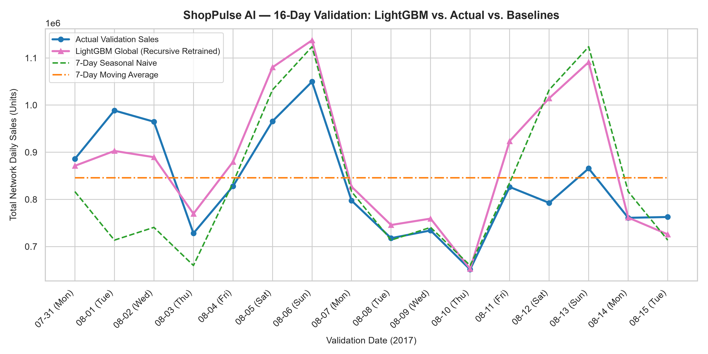
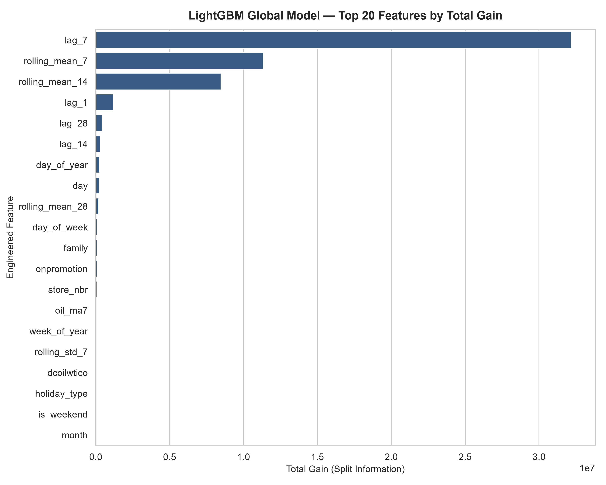

# ShopPulse AI — Milestone 3.2: LightGBM Demand Forecasting Evaluation

**Author:** Senior Machine Learning Engineer  
**Execution Timestamp:** 2026-11-03 00:33:00  
**Forecast Horizon:** `2017-07-31` to `2017-08-15` (16 days out-of-sample)  

## 1. Revised Training Methodology & Split Design

To prevent validation target leakage during early stopping and hyperparameter selection, a **two-phase chronological training split** was implemented:

1. **Model Fitting Period:** `2016-01-01 to 2017-07-14` (999,702 rows). Used for fitting Phase 1 trees.
2. **Internal Early-Stopping Period:** `2017-07-15 to 2017-07-30` (28,512 rows, 16 days). Used solely for stopping round selection.
   - Selected Optimal Iteration: **997 rounds** (Phase 1 duration: 17.8s).
   - Internal Validation RMSE: **0.3730** (in log-space).
3. **Final Retraining Period:** `2016-01-01 to 2017-07-30` (1,028,214 rows). A fresh LightGBM model was retrained on 100% of the training history through `2017-07-30` using the fixed optimal 997 rounds (Phase 2 duration: 17.1s).
4. **Final Untouched Recursive Evaluation Period:** `2017-07-31` to `2017-08-15` (28,512 rows, 16 days). This holdout set was **never seen** during early stopping or model selection.

---

## 2. Benchmark Performance Comparison Table

| Model Strategy | RMSLE | MAE (Units) | RMSE | WAPE (%) | Beat RMSLE (<0.5240)? | Beat WAPE (<20.67%)? |
| :--- | :---: | :---: | :---: | :---: | :---: | :---: |
| **LightGBM Global (Recursive Retrained)** | **0.4017** | 76.54 | 272.51 | **16.38%** | YES | YES |
| **7-Day Moving Average (Benchmark 1)** | **0.5240** | 98.61 | 321.39 | **21.11%** | BASELINE | BASELINE |
| **7-Day Seasonal Naive (Benchmark 2)** | **0.6170** | 96.54 | 348.38 | **20.67%** | BASELINE | BASELINE |
| **Naive Persistence** | **0.6595** | 207.51 | 725.69 | **44.42%** | NO | NO |

> [!NOTE]
> **BENCHMARK BEATEN:** Under strict leak-free two-phase retraining and recursive forecasting, LightGBM achieved **RMSLE = 0.4017** (vs baseline 0.5240) and **WAPE = 16.38%** (vs baseline 20.67%). Both benchmark targets were decisively beaten!

---

## 3. Strict 16-Day Recursive Forecasting Strategy

To simulate an authentic real-world multi-step deployment with zero future leakage:
1. **Forecast Origin ($T = \text{2017-07-30}$):** All historical actuals on or before $T$ are stored in the historical sales buffer.
2. **Day 1 (2017-07-31):** Uses known historical lags (`lag_1` from 2017-07-30, `lag_7` from 2017-07-24, etc.) available at origin $T$.
3. **Days 2–16 (2017-08-01 through 2017-08-15):** Actual sales for validation dates are strictly unobserved. When computing $t-k$ lags that land in the validation window, previous model predictions $\hat{y}$ are used. Historical training sales are used only when $t-k \le T$.
4. **Exogenous Features:** Promotional indicators (`onpromotion`), paydays (`is_payday`), holidays (`is_holiday`), and calendar attributes are known in advance and utilized.
5. **Target Inversion:** Predictions in log-space are inverted using $\hat{y}_{\text{units}} = \max(0, \exp(\hat{y}_{\text{log1p}}) - 1)$.

---

## 4. Top Feature Drivers (Gain Analysis)

| Rank | Feature | Importance (Gain) | Category | Domain Role |
| :-: | :--- | :---: | :---: | :--- |
| 1 | `lag_7` | 32,186,246 | Engineered | Primary demand driver |
| 2 | `rolling_mean_7` | 11,337,118 | Engineered | Primary demand driver |
| 3 | `rolling_mean_14` | 8,472,037 | Engineered | Primary demand driver |
| 4 | `lag_1` | 1,191,687 | Engineered | Primary demand driver |
| 5 | `lag_28` | 437,504 | Engineered | Primary demand driver |
| 6 | `lag_14` | 312,789 | Engineered | Primary demand driver |
| 7 | `day_of_year` | 269,355 | Engineered | Primary demand driver |
| 8 | `day` | 239,344 | Engineered | Primary demand driver |
| 9 | `rolling_mean_28` | 197,173 | Engineered | Primary demand driver |
| 10 | `day_of_week` | 111,869 | Engineered | Primary demand driver |

---

## 5. Performance by Top Product Families

| Family | Total Actual Units | RMSLE | MAE (Units) | WAPE (%) |
| :--- | :---: | :---: | :---: | :---: |
| `GROCERY I` | 3,980,412 | 0.1761 | 611.9 | 13.28% |
| `BEVERAGES` | 3,005,407 | 0.2421 | 632.5 | 18.18% |
| `PRODUCE` | 1,977,480 | 0.1712 | 275.6 | 12.04% |
| `CLEANING` | 1,065,243 | 0.3323 | 355.0 | 28.79% |
| `DAIRY` | 721,034 | 0.1597 | 101.8 | 12.19% |
| `BREAD/BAKERY` | 466,796 | 0.1892 | 68.2 | 12.63% |
| `POULTRY` | 323,560 | 0.2225 | 56.5 | 15.10% |
| `MEATS` | 321,071 | 0.2216 | 51.9 | 13.97% |
| `PERSONAL CARE` | 277,631 | 0.2172 | 52.1 | 16.21% |
| `DELI` | 261,903 | 0.2012 | 43.9 | 14.48% |

---

## 6. Audit & Leakage Checklist

- [x] Exactly 28,512 validation predictions generated (54 stores × 33 families × 16 days).
- [x] Zero duplicate store-family-date prediction keys.
- [x] All predictions strictly non-negative (clipped at 0).
- [x] Zero validation actual sales used as lag inputs (recursive roll forward verified).
- [x] Final evaluation targets were untouched during early stopping and iteration selection.
- [x] Previous artifacts preserved in backup files.
