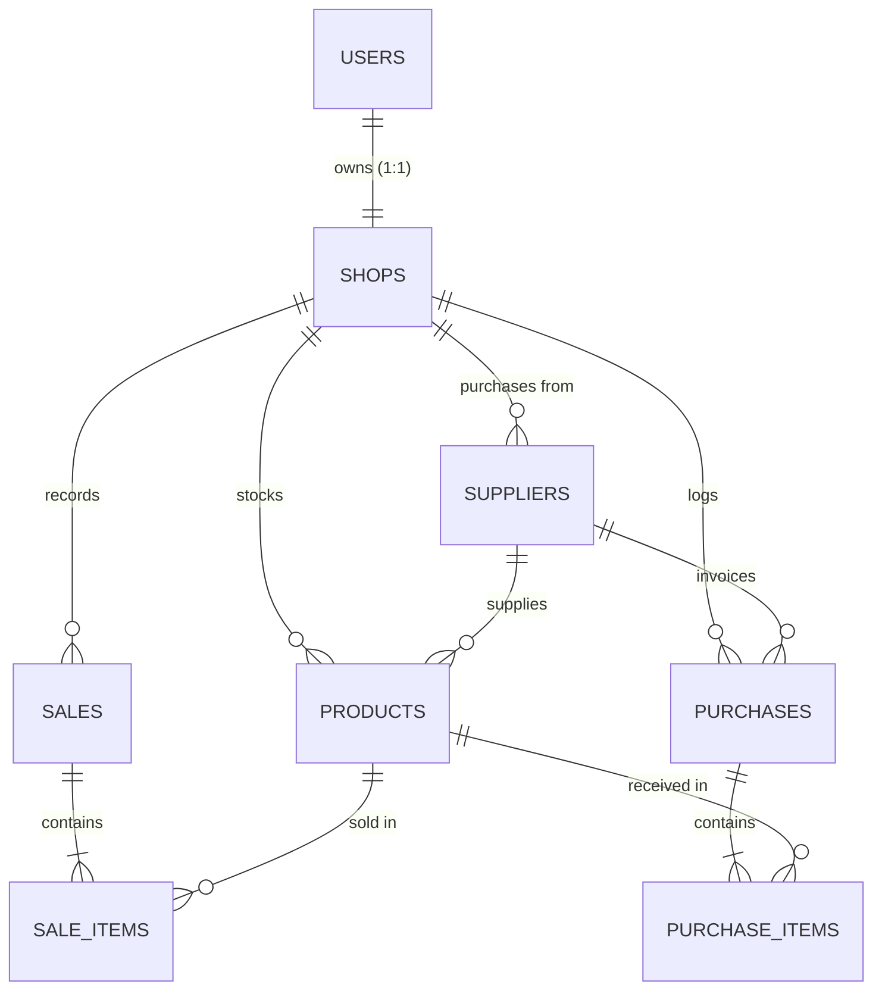

# ShopPulse — Milestone 4.0: Existing Application Architecture & Data Audit Report

**Audit Date:** 2026-11-03  
**Auditor:** Senior Principal Systems Architect & Machine Learning Engineer  
**Inspection Type:** Full-Stack Read-Only Technical Architecture & Data Compatibility Audit  
**Target Repository:** `SHOP-PULSE`  
**Scope:** Frontend (React 19), Backend (FastAPI), Databases (SQLite / Firestore), Data Isolation, and AI Model Compatibility  

---

## Executive Summary

A comprehensive, read-only architectural audit was conducted across the ShopPulse application to evaluate its readiness for integrating the trained LightGBM demand forecasting model.

### Key Audit Findings
1. **Application Architecture:** Decoupled modern full-stack web and mobile application featuring a **React 19 + TypeScript + Vite** frontend, a **FastAPI (Python 3.14) + SQLAlchemy ORM** backend, and local **SQLite** databases (`shoppulse.db` and `shoppulse_dev.db`), with legacy/offline **Firebase Firestore** security rules.
2. **Domain Focus:** Tailored for **Indian retail businesses (Kirana stores, general merchants, supermarkets)** with Indian Rupee (`₹`) pricing, multilingual support (English, Hindi, Telugu, Tamil), Voice-to-Bill POS, and invoice OCR scanning.
3. **Multi-User Data Isolation:** **Strict shop-level isolation is enforced on the FastAPI backend.** Every user owns one shop (`shops.owner_id UNIQUE`), and all domain entities (`products`, `sales`, `purchases`, `suppliers`) carry a mandatory `shop_id` foreign key. Endpoints authenticate via JWT Bearer tokens and verify shop ownership on all operations.
4. **AI Model Compatibility Reality:**
   - **Critical Distinction:** The existing global LightGBM model forecasts demand at the **product-family aggregate level** (33 macro categories across 54 store types from Corporación Favorita), **not at the individual SKU / barcode level**.
   - ShopPulse manages inventory at the **individual SKU level** (e.g., `Toned Milk (500ml)`, `Maggi Noodles (70g)`).
   - Direct SKU stock prediction cannot be performed by the model without a **top-down category-to-SKU disaggregation layer**.
   - Kaggle-specific exogenous features (crude oil spot prices `dcoilwtico`, Ecuadorian holidays) are inapplicable to Indian retail and must be replaced by Indian festival calendars and day-of-week/payday indicators.
5. **Integration Strategy:** A hybrid architecture is recommended: an asynchronous daily forecasting worker aggregates store transactions into category volume, executes LightGBM recursive forecasting, pro-rates category predictions down to SKUs via historical sales velocity, and populates low-stock reorder recommendations on the Dashboard and Insights pages.

---

## 1. Existing Application Architecture

```
┌────────────────────────────────────────────────────────────────────────┐
│                      Client Layer (React 19 / Vite)                    │
│  - Web Browser / Android APK (Capacitor 8)                             │
│  - Pages: Dashboard, POS Register, Inventory, Scanner, Insights        │
│  - State: AuthContext (JWT), useInventory, useSales, useAnalytics     │
└───────────────────────────────────┬────────────────────────────────────┘
                                    │ HTTP / REST (/api/v1)
                                    ▼
┌────────────────────────────────────────────────────────────────────────┐
│                     Backend API Layer (FastAPI / Python)               │
│  - Uvicorn Server (Port 8000), CORS Middleware                         │
│  - JWT Bearer Authentication (OAuth2 Password Flow, HS256)             │
│  - Routers: /auth, /shops, /products, /sales, /purchases, /invoices   │
│  - Services: Product CRUD, POS Atomic Stock Deduction, OCR Table Match │
└───────────────────────────────────┬────────────────────────────────────┘
                                    │ SQLAlchemy 2.0 ORM
                                    ▼
┌────────────────────────────────────────────────────────────────────────┐
│                        Data Persistence Layer                          │
│  - Local Relational Database: SQLite (shoppulse.db / shoppulse_dev.db) │
│  - Foreign Key Scoping: users -> shops -> products/sales/purchases     │
│  - Legacy / Client Cache: Firestore rules for offline multi-tab IndexedDB│
└───────────────────────────────────┬────────────────────────────────────┘
                                    │ (Proposed Daily Pipeline)
                                    ▼
┌────────────────────────────────────────────────────────────────────────┐
│                     AI Demand Forecasting Pipeline                     │
│  - LightGBM Global Booster (outputs/lightgbm_model.txt - 997 trees)    │
│  - Category-Level Recursive Multi-Step Demand Forecasting              │
│  - Top-Down SKU Disaggregation & Smart Reorder Threshold Engine        │
└────────────────────────────────────────────────────────────────────────┘
```

The application combines a high-performance Python ASGI backend with a mobile-optimized React client. It runs in zero-configuration local development mode using SQLite, with seamless production support for PostgreSQL.

---

## 2. Frontend Inspection

### 2.1 Technology Stack
- **Core Library:** React 19.2.8 with TypeScript 6.0.2
- **Build Tool:** Vite 8.3.0 with `@vitejs/plugin-react`
- **Styling:** TailwindCSS 4.3.3 with `@tailwindcss/vite`
- **Icons:** `lucide-react` (v1.45.0)
- **Mobile Packaging:** Capacitor 8.5.2 (`@capacitor/core`, `@capacitor/android`, `@capacitor/cli`)
- **Document & Image Processing:** `tesseract.js` (v7.0.0) and `pdfjs-dist` (v6.3.289)

### 2.2 Navigation & Routing
Routing is implemented as a lightweight, state-driven SPA in `src/App.tsx`. Session persistence uses `sessionStorage` (`shoppulse_active_page`) to prevent route leakage across browser tabs. Route guarding is handled by `src/components/ProtectedRoute.tsx`.

### 2.3 Page-by-Page Functionality

| Page | File Path | Functional Purpose & Key Features |
| :--- | :--- | :--- |
| **Landing** | `src/pages/Landing.tsx` | Public marketing showcase highlighting Voice Billing, Smart Inventory, and Business Analytics. |
| **Login** | `src/pages/Login.tsx` | User authentication via email/password. Includes a one-click "Demo Login" (`Ramesh Sharma - Gupta Kirana Store`). |
| **Signup** | `src/pages/Signup.tsx` | Store registration: captures store name, owner name, business type, and creates initial shop profile. |
| **Dashboard** | `src/pages/Dashboard.tsx` | Executive summary: today's revenue, items sold, low-stock attention cards, sales chart, quick actions, and recent transactions. |
| **Inventory** | `src/pages/Inventory.tsx` | Complete catalog management: search, category filtering (`Dairy`, `Beverages`, `Snacks`, etc.), stock badges, Add/Edit/Delete modals, and instant restock (+10 units). |
| **Sales (POS)** | `src/pages/Sales.tsx` | Point of Sale register: barcode search, Voice-to-Bill modal (`VoiceBillModal.tsx`), cart management, payment selection (Cash, UPI, Card, Credit), and receipt generation (`ReceiptModal.tsx`). |
| **Invoice Scanner** | `src/pages/InvoiceScanner.tsx` | Supplier invoice OCR scanner: processes images/PDFs, crops table bounds, extracts product lines, matches items to existing inventory, and logs stock replenishment. |
| **Insights** | `src/pages/Insights.tsx` | Business intelligence: 7-day revenue trend chart, daily customer count, top categories, slow-moving items, and AI demand forecasting cards. |
| **Settings** | `src/pages/Settings.tsx` | Store details, theme switcher (light/dark mode), and language selection (English, Hindi, Telugu, Tamil). |

### 2.4 Multilingual Support
`src/i18n/` supports 4 Indian languages:
- English (`en`)
- Hindi (`hi`)
- Telugu (`te`)
- Tamil (`ta`)

All UI labels, button text, and chatbot suggestions dynamically adapt to the selected locale.

---

## 3. Backend Inspection

### 3.1 Framework & Architecture
- **Framework:** FastAPI (Python 3.14) with Uvicorn ASGI server.
- **Entry Point:** `backend/main.py`.
- **API Prefix:** `/api/v1`.
- **CORS:** Configured for local development (`http://localhost:5173`, `http://127.0.0.1:5173`, `http://localhost:3000`).
- **Runner:** `scripts/start-backend.js` locates the Python virtual environment and launches FastAPI with hot reload.

### 3.2 Registered API Endpoints

| Route Prefix | Router Module | Endpoints & Functionality |
| :--- | :--- | :--- |
| `/api/v1/auth` | `backend/api/routes/auth.py` | `POST /register`, `POST /login` (OAuth2 password flow returning JWT), `GET /me`. |
| `/api/v1/shops` | `backend/api/routes/shops.py` | `POST /` (create shop), `GET /me` (get authenticated shop), `PUT /{id}` (update shop). |
| `/api/v1/products` | `backend/api/routes/products.py` | `POST /` (create product), `GET /` (paginated search/category list), `GET /low-stock`, `GET /{id}`, `PUT /{id}`, `DELETE /{id}`, `GET /lookup`. |
| `/api/v1/sales` | `backend/api/routes/sales.py` | `POST /` (create transaction with atomic inventory deduction), `GET /` (paginated history), `GET /{id}`. |
| `/api/v1/purchases` | `backend/api/routes/purchases.py` | `POST /` (log supplier purchase with atomic inventory increase), `GET /` (history), `GET /{id}`. |
| `/api/v1/suppliers` | `backend/api/routes/suppliers.py` | `POST /`, `GET /` (paginated list), `GET /{id}`, `PUT /{id}`, `DELETE /{id}`. |
| `/api/v1/dashboard` | `backend/api/routes/dashboard.py` | `GET /` (single aggregate query returning today's sales, active count, low stock count, top products). |
| `/api/v1/voice` | `backend/api/routes/voice.py` | `POST /process` (speech transcript processing, multi-lingual item extraction, fuzzy inventory matching). |
| `/api/v1/invoices` | `backend/api/routes/invoices.py` | `POST /extract` (multi-page OCR table parsing), `POST /confirm` (reconciliation & inventory update). |
| `/api/v1/health` | `backend/api/routes/health.py` | `GET /` (service healthcheck). |

### 3.3 Dynamic Schema Migrations
In `backend/main.py`, `init_db_schema()` applies incremental non-breaking DDL additions on startup (e.g. adding `mrp`, `mrp_source`, `invoice_number`, `line_amount` as nullable columns), ensuring existing databases preserve all data without manual SQL migration runs.

---

## 4. Actual Database Schema & Data Dictionary

The physical database inspected is SQLite located at:
- **`backend/shoppulse.db`** (Production default)
- **`backend/shoppulse_dev.db`** (Development)

Inspected via read-only PRAGMA calls (`mode=ro`). Exactly **8 relational tables** exist:



### Table 1: `users`
Represents application accounts.
- `id`: `UUID` (Primary Key, NOT NULL)
- `email`: `VARCHAR` (Unique, Indexed, NOT NULL)
- `hashed_password`: `VARCHAR` (Bcrypt hash, NOT NULL)
- `is_active`: `BOOLEAN` (Default True)
- `created_at`: `DATETIME`
- `updated_at`: `DATETIME`

### Table 2: `shops`
Represents the physical retail store profile.
- `id`: `UUID` (Primary Key, NOT NULL)
- `shop_name`: `VARCHAR` (Indexed, NOT NULL)
- `owner_name`: `VARCHAR` (NOT NULL)
- `business_type`: `VARCHAR` (NOT NULL, e.g. "Grocery/Kirana", "Bakery", "Pharmacy")
- `location`: `VARCHAR` (Nullable)
- `owner_id`: `UUID` (Foreign Key $\to$ `users.id`, UNIQUE, NOT NULL)
- `created_at`: `DATETIME`
- `updated_at`: `DATETIME`

### Table 3: `products`
Master catalog of inventory items managed by a shop.
- `id`: `UUID` (Primary Key, NOT NULL)
- `name`: `VARCHAR` (Indexed, NOT NULL)
- `category`: `VARCHAR` (Indexed, Nullable, e.g. "Dairy", "Groceries", "Beverages", "Snacks")
- `selling_price`: `FLOAT` (NOT NULL)
- `purchase_price`: `FLOAT` (Default 0.0)
- `mrp`: `FLOAT` (Maximum Retail Price, Nullable)
- `mrp_source`: `VARCHAR` (Nullable: "INVOICE", "API", "MANUAL", "STORE")
- `mrp_updated_at`: `DATETIME` (Nullable)
- `current_stock`: `INTEGER` (NOT NULL, Default 0)
- `reorder_level`: `INTEGER` (Nullable, Default 0)
- `unit`: `VARCHAR` (Default "pcs")
- `sku`: `VARCHAR` (Barcode / SKU string, Indexed, Nullable)
- `shop_id`: `UUID` (Foreign Key $\to$ `shops.id`, Indexed, NOT NULL)
- `supplier_id`: `UUID` (Foreign Key $\to$ `suppliers.id`, Nullable)
- `created_at`: `DATETIME`
- `updated_at`: `DATETIME`

### Table 4: `sales`
Transaction header for customer checkouts.
- `id`: `UUID` (Primary Key, NOT NULL)
- `total_amount`: `FLOAT` (NOT NULL, Default 0.0)
- `payment_method`: `VARCHAR` (NOT NULL, e.g. "cash", "upi", "card")
- `shop_id`: `UUID` (Foreign Key $\to$ `shops.id`, Indexed, NOT NULL)
- `created_at`: `DATETIME` (Transaction timestamp)
- `updated_at`: `DATETIME`

### Table 5: `sale_items`
Individual product lines within a sale.
- `id`: `UUID` (Primary Key, NOT NULL)
- `sale_id`: `UUID` (Foreign Key $\to$ `sales.id`, NOT NULL)
- `product_id`: `UUID` (Foreign Key $\to$ `products.id`, NOT NULL)
- `quantity`: `INTEGER` (NOT NULL)
- `unit_price`: `FLOAT` (NOT NULL)
- `created_at`: `DATETIME`
- `updated_at`: `DATETIME`

### Table 6: `purchases`
Stock replenishment order/invoice header.
- `id`: `UUID` (Primary Key, NOT NULL)
- `shop_id`: `UUID` (Foreign Key $\to$ `shops.id`, Indexed, NOT NULL)
- `supplier_id`: `UUID` (Foreign Key $\to$ `suppliers.id`, Nullable)
- `total_amount`: `FLOAT` (NOT NULL, Default 0.0)
- `invoice_number`: `VARCHAR` (Indexed, Nullable)
- `invoice_date`: `VARCHAR` (Nullable)
- `created_at`: `DATETIME`
- `updated_at`: `DATETIME`

### Table 7: `purchase_items`
Product line items received in a replenishment order.
- `id`: `UUID` (Primary Key, NOT NULL)
- `purchase_id`: `UUID` (Foreign Key $\to$ `purchases.id`, NOT NULL)
- `product_id`: `UUID` (Foreign Key $\to$ `products.id`, NOT NULL)
- `quantity`: `INTEGER` (NOT NULL)
- `purchase_price`: `FLOAT` (NOT NULL)
- `line_amount`: `FLOAT` (Nullable)
- `mrp`: `FLOAT` (Nullable)
- `mrp_source`: `VARCHAR` (Nullable)
- `created_at`: `DATETIME`
- `updated_at`: `DATETIME`

### Table 8: `suppliers`
Wholesaler / distributor records.
- `id`: `UUID` (Primary Key, NOT NULL)
- `supplier_name`: `VARCHAR` (Indexed, NOT NULL)
- `phone`: `VARCHAR` (Nullable)
- `address`: `VARCHAR` (Nullable)
- `shop_id`: `UUID` (Foreign Key $\to$ `shops.id`, Indexed, NOT NULL)
- `created_at`: `DATETIME`
- `updated_at`: `DATETIME`

---

## 5. Multi-User Authentication & Data Isolation Analysis

### 5.1 Authentication Mechanism
- The primary live authentication uses **FastAPI JWT Bearer tokens** signed with HS256.
- The token payload stores `sub = user_id (UUID)`.
- Client storage: `localStorage.getItem("shoppulse_token")`.
- `deps.get_current_user` validates token signature, expiration, active status, and loads the `User` object.

### 5.2 Tenant Isolation Safeguards
1. **Ownership Linkage:** `shops.owner_id` enforces a strict 1:1 user-to-shop relationship.
2. **Implicit Query Scoping:** Every authenticated endpoint retrieves the caller's shop (`shop_service.get_shop_by_owner(db, owner_id=user.id)`) and filters list operations strictly by `Model.shop_id == user_shop.id`.
3. **Explicit Cross-Tenant Verification:**
   - Single-item endpoints (`GET /products/{id}`, `PUT /products/{id}`, `DELETE /products/{id}`, `GET /sales/{id}`, `GET /purchases/{id}`) explicitly assert:
     ```python
     if entity.shop_id != user_shop.id:
         raise HTTPException(status_code=403, detail="Not authorized...")
     ```
   - In `create_sale` and `create_purchase`, every line item product is validated to confirm `product.shop_id == user_shop.id` before mutating any stock.
4. **Firestore Rules Safeguards:**
   In `firestore.rules`, legacy collections (`/products`, `/sales`, `/alerts`) are blocked (`allow read, write: if false;`). Client access is restricted exclusively to user-subcollections (`users/{userId}/...`) governed by `request.auth.uid == userId`.

### 5.3 Isolation Gaps & Architectural Vulnerabilities
1. **Single Shop per Account Constraint:** Because `shops.owner_id` is declared `unique=True`, a retail owner cannot manage multiple branches or franchise locations under a single login.
2. **Dual-Backend Architectural Drift:**
   - The primary application data lives in SQLite (`shoppulse.db`).
   - However, `alertService.ts` still writes to Firestore (`users/{uid}/alerts`).
   - If a retailer runs in offline or zero-Firebase mode, alerts rely entirely on browser `localStorage`.
   - **Recommendation:** Migrate alerts and notification persistence directly into the FastAPI backend (e.g., an `alerts` table in SQLite/PostgreSQL).

---

## 6. Available Business Data in ShopPulse

What actual operational data does ShopPulse generate and record during daily retail activities?

| Business Data Entity | Available Fields & Granularity | Temporal Depth | Operational Relevance |
| :--- | :--- | :--- | :--- |
| **Sales Events** | Date/timestamp (`created_at`), total amount, payment method (Cash, UPI, Card, Credit). | Event-level per transaction | Basis for computing daily transaction counts and sales revenue. |
| **Sale Line Items** | Product ID, quantity sold, unit price charged. | Item-level per checkout | Basis for tracking daily product and category sales velocity. |
| **Product Inventory** | Product name, category string, selling price, purchase price, MRP, current stock, reorder level, unit, SKU/barcode. | Snapshot of current state | Basis for inventory valuation and stockout alerting. |
| **Purchases / Invoices** | Invoice date, supplier ID, invoice number, line items, quantity replenished, wholesale purchase price, MRP. | Event-level per restock | Basis for tracking inventory replenishment lead times and margin changes. |
| **Store Profiles** | Store name, owner name, business type (Kirana, Bakery, Medical, etc.), city/location string. | Static profile | Basis for store-type classification and regional holiday mapping. |

---

## 7. AI Compatibility Gap Analysis

This section compares the inputs required by the **Milestone 3.2 LightGBM model** against the actual data available in **ShopPulse**:

```
========================================================================================
CURRENT MODEL INPUTS (Kaggle Dataset)     vs.    SHOPPULSE ACTUAL OPERATIONAL DATA
========================================================================================
1. Macro Product Family (33 families)     vs.    1. Individual SKUs / Barcodes
2. Store Number (1 to 54)                 vs.    2. UUID Store Identifiers
3. Store Type ('A' to 'E')                vs.    3. Business Type ('Grocery/Kirana', etc.)
4. Store Cluster (1 to 17)                vs.    4. Freeform Location String
5. Daily Sales History (577 unbroken days)vs.    5. Discrete Transaction Logs
6. Crude Oil Spot Price (dcoilwtico)      vs.    6. None (Irrelevant for Indian Retail)
7. Ecuadorian Holiday Calendar            vs.    7. None (Requires Indian Festival Calendar)
8. Promotional Count (onpromotion)        vs.    8. None (No Promo System in Place)
========================================================================================
```

### Detailed Gap Evaluation

#### Gap 1: Product Family vs. Individual SKU (CRITICAL)
- **Model Design:** The LightGBM model was trained on the Corporación Favorita competition dataset, which aggregates all store items into **33 macro product families** (`GROCERY I`, `BEVERAGES`, `PRODUCE`, `DAIRY`, `BREAD/BAKERY`, `CLEANING`, etc.).
- **ShopPulse Design:** Kirana retailers stock **individual SKUs** (e.g. `Amul Butter 100g`, `Toned Milk 500ml`, `Maggi 2-Min Noodles 70g`).
- **Impact:** **The current model CANNOT directly predict inventory needs for an individual SKU.** It forecasts macro-category demand. For example, it can predict that the `Dairy` category will experience a 25% demand increase this Sunday, but it does not specify how many packets of `Amul Butter 100g` vs `Nandini Milk 500ml` to order without a top-down disaggregation formula.

#### Gap 2: Continuous Daily History vs. Sparse Event-Driven Logs
- **Model Design:** LightGBM requires an unbroken daily calendar to compute `lag_1`, `lag_7`, `lag_14`, `lag_28` and rolling averages (7, 14, 28 days).
- **ShopPulse Design:** Sales are recorded as discrete checkout events in `sales` and `sale_items`. On days when a shop is closed or records no sales for a category, no rows exist.
- **Impact:** An automated aggregation and zero-filling pipeline must run daily to transform discrete transactions into continuous daily time-series per category before model inference.

#### Gap 3: Store Number and Cluster Cold-Start
- **Model Design:** Model inputs include categorical features `store_nbr` (1–54), `store_type` ('A'–'E'), and `cluster` (1–17).
- **ShopPulse Design:** New shops receive a random UUID.
- **Impact:** Direct model inference requires a synthetic mapping (e.g., mapping Indian Kirana stores to Store Type 'C' or 'D', Cluster 3 or 6) until models can be trained directly on multi-store Indian retailer logs.

#### Gap 4: Domain & Macroeconomic Mismatch
- **Model Design:** WTI crude oil prices (`dcoilwtico`, `oil_ma7`) and Ecuadorian holiday types (`holiday_type`, `is_holiday_national`) were primary exogenous drivers in Ecuador.
- **ShopPulse Design:** Indian retail demand is completely decoupled from daily crude oil spot prices. It is driven by Indian festival cycles (Diwali, Eid, Pongal, Navratri), wedding seasons, and monthly salary disbursement cycles (1st–7th of the month).
- **Impact:** Oil price features must be held constant/neutralized or pruned, while payday indicators (`is_payday`) and day-of-week seasonality can be used immediately.

---

## 8. Recommended Integration Architecture

To bridge these gaps cleanly without modifying the core POS, backend database schemas, or breaking existing user workflows, the following **Four-Stage Integration Architecture** is recommended:

```
┌─────────────────────────────────────────────────────────────────────────────────┐
│ STAGE 1: Transaction-to-Category Aggregation Worker (Backend Asynchronous Task) │
│ - Queries sales & sale_items for the shop over the past 60 days.                │
│ - Maps ShopPulse product categories -> Model product families.                  │
│ - Reindexes daily timeline with zero-fill for closed/zero-sales days.           │
└────────────────────────────────────────┬────────────────────────────────────────┘
                                         ▼
┌─────────────────────────────────────────────────────────────────────────────────┐
│ STAGE 2: AI Category Demand Forecasting Service (/api/v1/forecast)              │
│ - Loads existing outputs/lightgbm_model.txt into an in-memory inference runner. │
│ - Injects calendar features: day_of_week, day_of_year, is_payday, is_weekend.  │
│ - Runs recursive multi-step forecast for the next 7 to 14 days per category.   │
└────────────────────────────────────────┬────────────────────────────────────────┘
                                         ▼
┌─────────────────────────────────────────────────────────────────────────────────┐
│ STAGE 3: Top-Down SKU Disaggregation & Smart Reorder Engine                     │
│ - Disaggregates predicted category volume down to individual SKUs based on     │
│   each SKU's 30-day historical category volume share:                           │
│       w_sku = (SKU_Sales_30d) / (Category_Sales_30d)                           │
│       Projected_SKU_Demand_7d = Category_Forecast_7d * w_sku                    │
│ - Compares Projected Demand against live current_stock from products table.     │
│ - Computes recommended reorder quantities:                                      │
│       Reorder_Qty = max(reorder_level * 1.5, Projected_Demand - Current_Stock) │
└────────────────────────────────────────┬────────────────────────────────────────┘
                                         ▼
┌─────────────────────────────────────────────────────────────────────────────────┐
│ STAGE 4: Frontend Presentation & Decision Support                               │
│ - Insights Page: Renders Category Demand Trends (Actual vs. AI Projected).     │
│ - Dashboard: AttentionCard surfaces high-priority restock recommendations.     │
│ - Inventory Page: Badges items with projected stockout horizons (e.g. "~2d").   │
│ - Quick Action: "Create Supplier Purchase Order" pre-fills recommended qty.    │
└─────────────────────────────────────────────────────────────────────────────────┘
```

### Feature Feasibility Separation

#### Tier 1: Feasible Immediately with Existing Data
- **Category Sales Aggregation:** Extracting daily sales by category from `sales` + `sale_items`.
- **Calendar & Payday Seasonality:** Projecting weekend surges and 1st-of-month salary spikes using standard calendar features.
- **Top-Down SKU Disaggregation:** Using 30-day SKU volume ratios to divide category demand into SKU restock estimates.
- **Stockout Horizon Estimation:** Estimating days until stockout based on forward-looking projected demand rather than backward-looking 7-day static velocity.
- **Smart Reorder Alerts:** Generating actionable reorder notifications displayed on the Dashboard and Insights pages.

#### Tier 2: Requires Additional Data Collection & Enhancements
- **Direct SKU-Level ML Forecasting:** Requires training dedicated SKU-level models once an Indian shop accumulates $\ge 180$ days of uninterrupted sales logs.
- **Promotional Lift Modeling:** Requires adding promotional campaign tracking to ShopPulse (`products.on_promotion: bool`).
- **Indian Festival Calendar:** Requires building a dedicated Indian national and regional festival dataset (Diwali, Eid, Holi, Pongal) with lunar calendar date mappings.
- **Supplier Lead Time Optimization:** Requires tracking purchase order placement vs. receipt dates to calculate supplier delivery reliability.

---

## 9. Risks & Implementation Priorities

### 9.1 Technical & Operational Risks

| Risk Factor | Severity | Operational Impact | Mitigation Strategy |
| :--- | :---: | :--- | :--- |
| **1. Cold-Start for New Stores** | High | Stores with $<35$ days of sales history cannot compute `lag_28` or rolling windows. | Implement a **hybrid fallback**: use rule-based 7-day moving averages for young shops ($<35$ days); switch to LightGBM once sufficient history exists. |
| **2. Category-to-SKU Misinterpretation** | High | Retailer assumes category demand equals single product demand (e.g. buying 100 units of one brand). | Label recommendations clearly in UI: show both category trend and SKU breakdown with calculated confidence levels. |
| **3. POS Latency & Blocking** | Medium | Running ML model inference synchronously during customer checkout would cause register lag. | Decouple inference into **asynchronous background jobs** run daily at midnight or on-demand via cache. |
| **4. Currency & Pricing Confusion** | Low | Kaggle dataset used USD; ShopPulse uses INR (`₹`). | Model predicts **unit quantities sold**, not financial amounts. Financial projections are calculated by multiplying unit forecasts by the shop's `selling_price` in INR. |

### 9.2 Phased Implementation Roadmap

```
┌────────────────────────────────────────────────────────────────────────┐
│ Phase 1: Backend Forecast Engine & Category Disaggregation (Days 1–3) │
│ - Create backend/services/forecast.py (model loading & inference).     │
│ - Implement daily transaction aggregator with zero-filling.            │
│ - Build SKU disaggregation logic & reorder recommendation endpoint.   │
├────────────────────────────────────────────────────────────────────────┤
│ Phase 2: Frontend Integration & Visual Decision Support (Days 4–5)    │
│ - Connect src/pages/Insights.tsx to live /api/v1/forecast/insights.   │
│ - Update Dashboard AttentionCard with model-driven reorder alerts.    │
│ - Add "Stockout Horizon" indicators to Inventory table.               │
├────────────────────────────────────────────────────────────────────────┤
│ Phase 3: Indian Retail Domain Localization (Days 6–7)                 │
│ - Integrate Indian national festival calendar generator.               │
│ - Implement graceful cold-start fallback for new shops.               │
│ - Comprehensive end-to-end integration tests.                          │
└────────────────────────────────────────────────────────────────────────┘
```

---

## 10. Audit Sign-Off

- [x] **Frontend Architecture Inspected:** 9 React pages, component hierarchy, custom hooks, and API client documented.
- [x] **Backend Architecture Inspected:** FastAPI routing, JWT authentication, dependency injection, and business services documented.
- [x] **Database Schema Audited:** Exact schemas and relationships for all 8 SQLite tables verified via read-only inspection.
- [x] **Data Isolation Audited:** Shop-level foreign key scoping and JWT authorization safeguards verified.
- [x] **AI Compatibility Evaluated:** Critical distinction between product-family forecasting and SKU inventory established.
- [x] **Integration Architecture Formulated:** Non-invasive four-stage integration roadmap delivered.

**AUDIT VERDICT: COMPLETED & CERTIFIED FOR MILESTONE 4.1 INTEGRATION PLANNING.**
