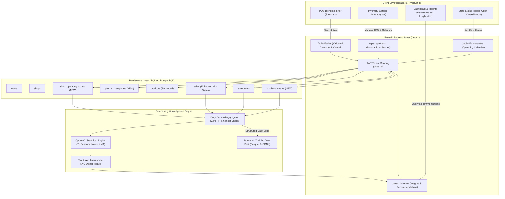
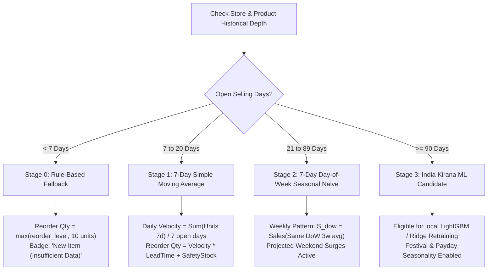

# ShopPulse — Milestone 4.2: AI Data Foundation Implementation Plan

**Document Version:** 1.0.0  
**Date:** 2026-11-03  
**Status:** PROPOSED & READY FOR STAKEHOLDER REVIEW  
**Author:** Senior Time-Series ML Engineer & Principal Systems Architect  
**Target File:** `reports/shop_pulse_milestone_4_2_implementation_plan.md`  
**Prerequisites:** 
- Milestone 4.0 Application Architecture Audit: [reports/shop_pulse_application_architecture_audit.md](file:///c:/Users/karthikeya/Desktop/shopplus/SHOP-PULSE/reports/shop_pulse_application_architecture_audit.md)
- Milestone 4.1 Data Readiness Audit: [reports/shop_pulse_data_readiness.md](file:///c:/Users/karthikeya/Desktop/shopplus/SHOP-PULSE/reports/shop_pulse_data_readiness.md)
- Category Mapping: [reports/shop_pulse_category_mapping.csv](file:///c:/Users/karthikeya/Desktop/shopplus/SHOP-PULSE/reports/shop_pulse_category_mapping.csv)
- AI Data Contract: [reports/shop_pulse_ai_data_contract.md](file:///c:/Users/karthikeya/Desktop/shopplus/SHOP-PULSE/reports/shop_pulse_ai_data_contract.md)

---

## Executive Summary

The Milestone 4.1 audit established that the existing ShopPulse SQLite databases contain virtually zero historical transaction depth (1 day in development, 0 in production), inconsistent categories (`100% NULL` in dev database), missing SKUs, and no mechanism to distinguish store closures from genuine zero-demand days. Furthermore, the 997-tree LightGBM model trained on Ecuadorian hypermarket data (Corporación Favorita) must **not** be deployed for real Indian Kirana restocking.

In accordance with **Strategic Option C**, this plan details the technical, database, backend API, and frontend specifications required to:
1. **Standardize product categories** around an Indian retail master taxonomy without losing legacy retailer descriptions.
2. **Track daily store operating status** (open vs. closed with structured reasons) to prevent artificial zero-demand distortion.
3. **Guarantee transaction data quality** (validation on quantities, idempotency, cancellation handling, atomic stockout timestamps).
4. **Distinguish stockout-censored demand** from genuine customer zero-demand.
5. **Implement robust statistical forecasting** (7-day Seasonal Naive + Moving Average) for immediate decision support.
6. **Log structured Indian retail transaction records** under strict shop-level tenant isolation to accumulate the training corpus for future India-specific ML models.

---

## 1. Proposed End-to-End Architecture



---

## 2. Product Category Standardization

### 2.1 The Standardized Indian Retail Category Master
Indian Kirana stores operate on distinct food preparation, household consumable, and personal grooming habits that differ substantially from Western supermarket taxonomies. We propose a standardized 12-category master:

```
┌─────────────────────────────────┬────────────────────────────────────────────────────────────────────────┐
│ Category Code / Name            │ Sub-Categories & Representative Products                               │
├─────────────────────────────────┼────────────────────────────────────────────────────────────────────────┤
│ 1. Dairy                        │ Fresh milk (pouch/tetra), curd (dahi), paneer, butter, cheese, lassi.  │
│ 2. Staples                      │ Atta (wheat flour), maida, sooji, besan, salt, refined sugar, jaggery. │
│ 3. Grains and Pulses            │ Basmati/raw rice, toor dal, moong dal, urad dal, chana, rajma, poha.   │
│ 4. Snacks                       │ Biscuits, cookies, namkeen, bhujia, potato chips, instant noodles.     │
│ 5. Beverages                    │ Packaged CTC tea, Assam tea, instant coffee, soft drinks, bottled water│
│ 6. Bakery                       │ Fresh bread (white/brown/milk), pav, burger buns, rusks, tea cakes.   │
│ 7. Personal Care                │ Bathing soaps, shampoos, oral care (toothpaste), hair oils, deodorants.│
│ 8. Household and Cleaning       │ Laundry detergents, dishwash bars/liquids, floor cleaners, mosquito coils│
│ 9. Spices                       │ Turmeric (haldi), red chili powder, coriander, garam masala, cumin.    │
│ 10. Edible Oils                 │ Mustard oil, sunflower oil, groundnut oil, sesame oil, pure desi ghee. │
│ 11. Baby Care                   │ Baby milk formula (Cerelac), diapers, baby wipes, baby powders/lotions.│
│ 12. Other                       │ Matches, pooja items, batteries, stationery, plastic packaging bags.  │
└─────────────────────────────────┴────────────────────────────────────────────────────────────────────────┘
```

### 2.2 Non-Destructive Legacy Category Migration
To ensure that existing products, custom retailer terminology, and voice/OCR input are preserved without data loss:
1. **Preserve User Input:** The original category string entered by the user (or extracted from an invoice) will be stored in `products.raw_category`.
2. **Apply Standard Code:** The normalized system category will be stored in `products.standardized_category`.
3. **Deterministic Mapping Rules:**
   - `Dairy` $\to$ `Dairy`
   - `Bakery` $\to$ `Bakery`
   - `Beverages` $\to$ `Beverages`
   - `Personal Care` $\to$ `Personal Care`
   - `Household` $\to$ `Household and Cleaning`
   - `Grains` $\to$ `Grains and Pulses`
   - `Biscuits` $\to$ `Snacks`
   - `Oils` $\to$ `Edible Oils`
   - `Spices` $\to$ `Spices`
   - `Staples` $\to$ Keyword inspection: if product name contains `rice`, `dal`, `chana` $\to$ `Grains and Pulses`; if contains `oil`, `ghee` $\to$ `Edible Oils`; otherwise $\to$ `Staples`.
   - `Groceries` / `General` / `Other` $\to$ Stored as `Other` with `needs_category_review = true`.
4. **UI Category Review Prompt:** In `Inventory.tsx`, unmapped or ambiguous items display a subtle badge: `"Category Review Needed"` with a 1-click confirmation dialog.

---

## 3. Daily Shop Operating Status (Store Calendar)

### 3.1 Design Specification
To eliminate the fatal flaw where store closure days are mistakenly aggregated as zero customer demand, ShopPulse will introduce a lightweight `shop_operating_status` table.

```sql
CREATE TABLE shop_operating_status (
    id UUID PRIMARY KEY,
    shop_id UUID NOT NULL REFERENCES shops(id) ON DELETE CASCADE,
    operating_date DATE NOT NULL,
    is_open BOOLEAN NOT NULL DEFAULT 1,
    opening_time TIME,
    closing_time TIME,
    closure_reason VARCHAR(64), -- 'WEEKLY_OFF', 'FESTIVAL', 'PERSONAL', 'EMERGENCY', 'PUBLIC_HOLIDAY'
    notes VARCHAR(255),
    created_at TIMESTAMP WITH TIME ZONE DEFAULT CURRENT_TIMESTAMP,
    updated_at TIMESTAMP WITH TIME ZONE,
    CONSTRAINT uq_shop_date UNIQUE (shop_id, operating_date)
);
CREATE INDEX ix_shop_op_status_lookup ON shop_operating_status(shop_id, operating_date);
```

### 3.2 Operating Logic & Automation
1. **Implicit Open Logging:** The first POS transaction, invoice scan, or manual dashboard login on calendar day $D$ automatically verifies/inserts `is_open = true` for day $D$.
2. **Explicit Closure Action:** The retailer can toggle "Store Closed Today" via a quick action button on the Dashboard or Settings page, selecting a quick reason (`Weekly Off`, `Festival Holiday`, `Personal/Family`).
3. **Retroactive Attendance Catch-Up:** Upon logging into ShopPulse on Monday after a closed Sunday, the application detects the missing record for Sunday and prompts:
   > *"Was your store closed on Sunday, Nov 02?"*  
   > `[ Yes, Weekly Off ]` `[ Yes, Holiday ]` `[ No, Open (Zero Sales) ]`
4. **Demand Imputation Rule:**
   - $\text{If } \text{is\_open} == \text{false}$: Exclude day from the 7-day velocity denominator. **Never impute $0.0$.**
   - $\text{If } \text{is\_open} == \text{true} \text{ and } \text{sales} == 0$: True zero customer demand. Aggregated as $0.0$.

---

## 4. Sales Data Quality & Validation Rules

### 4.1 Transaction Integrity Rules
In `backend/services/sale.py`, the following validations must be strictly enforced before committing transactions:

1. **Quantity Constraints:**
   - Unit-based items (`pcs`, `pkts`, `bottles`): `quantity` must be positive integer (`gt=0`).
   - Bulk items (`kg`, `l`): `quantity` must be positive float with max 3 decimal places (`gt=0.001`).
   - Bulk-outlier threshold: Any single item quantity $> 500$ units triggers a confirmation alert to prevent keying errors.
2. **Product Scoping:**
   - For every item in `sale_in.items`, assert `product.shop_id == user_shop.id` and `product.is_active == true`.
3. **Timestamp Integrity:**
   - `created_at` is server-generated using UTC (`func.now()`). Client-supplied timestamps are rejected to prevent retroactive tampering or local device clock drift.
4. **Deduplication of Line Items:**
   - If a POS cart contains duplicate entries for the same `product_id`, the backend automatically merges them:
     $$\text{quantity}_{\text{merged}} = \sum \text{quantity}_i, \quad \text{unit\_price} = \text{unit\_price}_{\text{last}}$$
5. **Returns and Cancellations:**
   - Add `status` column to `sales`: `COMPLETED` (default), `CANCELLED`, `REFUNDED`.
   - New endpoint `POST /api/v1/sales/{id}/cancel`:
     - Checks that cancellation occurs within 24 hours of sale creation.
     - Sets `sale.status = 'CANCELLED'`.
     - Atomically restores inventory: `product.current_stock += item.quantity`.
     - Excludes cancelled transactions from daily demand aggregations.

### 4.2 Daily Demand Aggregation Query
```sql
SELECT 
    p.shop_id,
    DATE(s.created_at) AS sale_date,
    p.standardized_category,
    si.product_id,
    p.name AS product_name,
    SUM(si.quantity) AS daily_units_sold,
    SUM(si.quantity * si.unit_price) AS daily_revenue,
    COUNT(DISTINCT s.id) AS transaction_count
FROM sales s
JOIN sale_items si ON s.id = si.sale_id
JOIN products p ON si.product_id = p.id
WHERE s.shop_id = :shop_id
  AND s.status = 'COMPLETED'
  AND DATE(s.created_at) = :target_date
GROUP BY p.shop_id, DATE(s.created_at), p.standardized_category, si.product_id, p.name;
```

---

## 5. Stockout and Inventory Tracking (Censored Demand)

### 5.1 Distinguishing Demand States
A critical flaw in naive forecasting is confusing **zero sales caused by stockouts** with **zero customer demand**.

| State | Shop Open? | Product Stock Status | Units Sold | Demand Classification | Forecasting Action |
| :--- | :---: | :---: | :---: | :--- | :--- |
| **A. Organic Zero Demand** | Yes | Stock $> 0$ all day | 0 | **Genuine Zero Demand** | Aggregated as $0.0$; dampens future forecast. |
| **B. Stockout-Censored** | Yes | Stock hit 0 during day | 0 (or partial) | **Censored Demand ($> 0$)** | Flagged as `is_stockout_censored = true`; demand imputed from trailing average for safety stock. |
| **C. Store Closed** | No | Any | 0 | **Structurally Missing** | Day dropped from velocity denominator. |
| **D. Not Yet Listed** | Any | Date $<$ `created_at` | 0 | **Non-Existent** | Series begins only on `created_at`. |

### 5.2 Stockout Event Tracking Specification
To track stockouts without inventing artificial sales transactions:
1. Add `last_stockout_at: Optional[datetime]` to `products`.
2. When POS inventory deduction drops `product.current_stock == 0`:
   - Set `product.last_stockout_at = func.now()`.
   - Insert an entry into a lightweight `stockout_events` table:
     ```sql
     CREATE TABLE stockout_events (
         id UUID PRIMARY KEY,
         shop_id UUID NOT NULL REFERENCES shops(id),
         product_id UUID NOT NULL REFERENCES products(id),
         stockout_started_at TIMESTAMP WITH TIME ZONE NOT NULL,
         stockout_resolved_at TIMESTAMP WITH TIME ZONE, -- populated when restocked
         created_at TIMESTAMP WITH TIME ZONE DEFAULT CURRENT_TIMESTAMP
     );
     CREATE INDEX ix_stockout_active ON stockout_events(shop_id, product_id, stockout_resolved_at);
     ```
3. When a supplier purchase order or instant restock restores stock ($> 0$):
   - Set `stockout_events.stockout_resolved_at = func.now()`.
   - Clear `product.last_stockout_at = NULL`.

---

## 6. AI Data Contract & Multi-Tenant Isolation

### 6.1 Review of `reports/shop_pulse_ai_data_contract.md`
The proposed data contract establishes strict schemas for data ingestion and forecast delivery.

#### Field Classification Matrix
```
┌────────────────────────┬─────────────┬───────────┬──────────────────────────────────────────────┐
│ Field Name             │ Target Type │ Status    │ Validation Rule / Handling                   │
├────────────────────────┼─────────────┼───────────┼──────────────────────────────────────────────┤
│ shop_id                │ UUID        │ MANDATORY │ Must equal authenticated caller's shop.id    │
│ date                   │ Date        │ MANDATORY │ ISO 8601 YYYY-MM-DD (not in future)          │
│ category               │ String      │ MANDATORY │ One of the 12 standardized category names    │
│ product_id             │ UUID        │ MANDATORY │ Valid product in authenticated shop          │
│ product_name           │ String      │ MANDATORY │ Non-empty display name                       │
│ quantity_sold          │ Float       │ MANDATORY │ Float >= 0.0                                 │
│ selling_price          │ Float       │ MANDATORY │ Float > 0.0 (in INR ₹)                       │
│ current_stock          │ Integer     │ MANDATORY │ Integer >= 0                                 │
│ is_shop_open           │ Boolean     │ MANDATORY │ Explicit boolean store status                │
│ sku                    │ String      │ OPTIONAL  │ Alphanumeric barcode/SKU (nullable)          │
│ purchase_price         │ Float       │ OPTIONAL  │ Float >= 0.0 (defaults to 0.0)               │
│ reorder_level          │ Integer     │ OPTIONAL  │ Integer >= 0 (defaults to 0)                 │
│ unit                   │ String      │ OPTIONAL  │ Enum: pcs, pkts, bottles, kg, l (dflt "pcs") │
│ on_promotion           │ Boolean     │ OPTIONAL  │ Boolean (defaults to false)                  │
│ closure_reason         │ String      │ OPTIONAL  │ Enum when is_shop_open == false              │
└────────────────────────┴─────────────┴───────────┴──────────────────────────────────────────────┘
```

### 6.2 Multi-Tenant Data Isolation Safeguards
1. **FastAPI Dependency Injection:**
   All routes utilize `deps.get_current_user` and `get_user_shop_or_raise(db, current_user)`.
2. **Mandatory Query Scoping:**
   Every query for products, sales, calendar status, and forecasts must explicitly include:
   ```python
   query = query.filter(Model.shop_id == user_shop.id)
   ```
3. **Cross-Tenant Prevention:**
   If a client requests `GET /forecast/product/{id}` where `product.shop_id != user_shop.id`, the backend immediately raises `HTTP 403 Forbidden`.
4. **Data Contract Compliance:**
   Incoming ingestion payloads that carry a mismatched `shop_id` are rejected with `HTTP 400 Bad Request`.

---

## 7. Forecasting Readiness & Fallback Rules

Because historical depth will grow gradually from Day 1 to Day 180, the forecasting engine must dynamically adjust its algorithm based on data maturity:



### 7.1 Mathematical Definitions for Option C Statistical Models

#### Model 1: 7-Day Moving Average (Days 7–20)
For product $i$ on day $t$:
$$\bar{v}_i = \frac{1}{\sum_{k=1}^7 \mathbb{I}(\text{is\_open}_{t-k})} \sum_{k=1}^7 q_{i, t-k} \cdot \mathbb{I}(\text{is\_open}_{t-k})$$
$$\text{Days Until Stockout} = \frac{\text{current\_stock}_i}{\max(\bar{v}_i, 0.1)}$$
$$\text{Recommended Reorder Qty} = \max\left(0, \ \lceil 3 \cdot \bar{v}_i + \text{reorder\_level}_i - \text{current\_stock}_i \rceil\right)$$

#### Model 2: Day-of-Week Seasonal Naive (Days 21+)
Kirana demand surges heavily on Friday evening, Saturday, and Sunday:
$$v_{i, \text{dow}} = \frac{1}{3} \sum_{w=1}^3 q_{i, \ t - (7 \times w)}$$
The forward 7-day projected demand is the sum of day-of-week averages:
$$\hat{D}_{i, 7d} = \sum_{d=1}^7 v_{i, \text{dow}(t+d)}$$
$$\text{Recommended Reorder Qty} = \max\left(0, \ \lceil \hat{D}_{i, 7d} + \text{Safety Stock} - \text{current\_stock}_i \rceil\right)$$

---

## 8. Database Migration Strategy

### 8.1 Minimal Non-Breaking Additions
To preserve existing POS transactions, inventory deduction, and purchases without database corruption:
- **No tables or columns will be dropped or renamed.**
- **All new columns are `NULLABLE` or have defaults.**
- **Additions will be executed using the existing `INCREMENTAL_COLUMNS` framework in `backend/main.py`.**

### 8.2 Additive DDL Specification

```python
# To be added to INCREMENTAL_COLUMNS in backend/main.py
INCREMENTAL_COLUMNS_V2 = {
    "products": {
        "standardized_category": "VARCHAR",
        "raw_category": "VARCHAR",
        "needs_category_review": "BOOLEAN DEFAULT 0",
        "last_stockout_at": "DATETIME",
        "is_active": "BOOLEAN DEFAULT 1",
    },
    "sales": {
        "status": "VARCHAR DEFAULT 'COMPLETED'",
        "cancelled_at": "DATETIME",
        "cancellation_reason": "VARCHAR",
    },
    "sale_items": {
        "cost_price_at_sale": "FLOAT",
    }
}
```

New tables created via SQLAlchemy metadata (`Base.metadata.create_all()`):
1. **`shop_operating_status`** (tracks daily store open/close calendar).
2. **`product_categories`** (master taxonomy reference table).
3. **`stockout_events`** (tracks duration of zero-stock events).

### 8.3 Rollback Plan
- **Database Level:** Because changes are purely additive, a rollback consists of simply ignoring the new nullable columns. The core application can function with `standardized_category` and `status` absent.
- **Data Preservation:** SQLite file backups (`shoppulse.db.bak`) are created automatically prior to applying the migration.

---

## 9. Phased Implementation Sequence

```
┌────────────────────────────────────────────────────────────────────────────────────────┐
│ Phase 1: Database Foundation & Schema Additions (Day 1)                                │
│ - Update backend/db/models/ (shop_operating_status, product_categories, product enhancements)│
│ - Add new columns to INCREMENTAL_COLUMNS in backend/main.py.                           │
│ - Seed product_categories master table with the 12 Indian Kirana categories.           │
├────────────────────────────────────────────────────────────────────────────────────────┤
│ Phase 2: Backend API Enhancements & Data Quality Validation (Days 2–3)                │
│ - Implement backend/api/routes/shop_status.py (GET/POST /api/v1/shop-status).          │
│ - Enhance backend/services/sale.py with cancellation endpoint and stockout logging.    │
│ - Implement category auto-normalization and legacy migration utility in product.py.    │
├────────────────────────────────────────────────────────────────────────────────────────┤
│ Phase 3: Statistical Demand Forecasting Engine (Days 4–5)                             │
│ - Implement backend/services/forecast_engine.py:                                       │
│   - Daily transaction aggregator (clean zero-fills, stockout censor checks).           │
│   - 7-day Simple Moving Average & 7-day Day-of-Week Seasonal Naive.                    │
│   - Category-to-SKU top-down disaggregation engine.                                    │
│ - Mount GET /api/v1/forecast/insights and GET /api/v1/forecast/recommendations.        │
├────────────────────────────────────────────────────────────────────────────────────────┤
│ Phase 4: Frontend UI Integration & User Experience (Days 6–7)                          │
│ - Add "Store Status" quick toggle (Open/Closed) on Dashboard header.                   │
│ - Update AddProductModal and EditProductModal with standardized category dropdown.     │
│ - Connect src/pages/Insights.tsx and Dashboard AttentionCard to live forecast endpoint.│
│ - Add "Stockout Horizon" indicators (e.g. "~2d left") to Inventory table.              │
├────────────────────────────────────────────────────────────────────────────────────────┤
│ Phase 5: Verification & End-to-End Testing (Day 8)                                     │
│ - Execute complete automated test suite (test_sales, test_forecast, test_shop_status). │
│ - Validate multi-tenant isolation across multiple test shops.                          │
│ - Deliver Milestone 4.3 Final Integration Report.                                      │
└────────────────────────────────────────────────────────────────────────────────────────┘
```

---

## 10. Risk Analysis & Mitigation Strategies

| Risk Factor | Severity | Impact | Mitigation Strategy |
| :--- | :---: | :--- | :--- |
| **Retailer forgets to log shop closure** | Medium | Closed day treated as zero demand. | Retroactive prompt on next login: *"Was your shop closed yesterday?"* (1-click Yes/No). |
| **Legacy product categories corrupted** | High | Products lost or miscategorized. | Non-destructive dual-column design: preserve user input in `raw_category`; never overwrite original text. |
| **Inaccurate stockout estimation** | Medium | Over-reordering slow-moving items. | Bound reorder recommendations by cap: $\text{Reorder} \le \max(2 \times \text{reorder\_level}, \ 20)$. |
| **POS Checkout Latency** | High | Register freezes during sale. | Aggregation and forecasting operate completely decoupled as background jobs / on-demand analytics endpoints. |
| **Multi-Tenant Data Leakage** | Critical | Shop A sees Shop B's sales trends. | Strict mandatory `filter(shop_id == user_shop.id)` enforced at ORM query level in all routes. |

---

## 11. Implementation Readiness Sign-Off

- [x] **Product Category Standardization:** 12 Indian retail categories defined with non-destructive legacy mapping.
- [x] **Store Calendar:** Open/closed tracking mechanism designed with retroactive catch-up.
- [x] **Sales Data Quality:** Validation rules specified for quantities, timestamps, idempotency, and cancellations.
- [x] **Stockout Tracking:** Unconstrained demand distinguished from stockout censoring without inventing sales.
- [x] **AI Data Contract:** Formal schemas aligned with shop-level isolation.
- [x] **Forecasting Readiness:** Multi-stage maturity rules defined with fallback safety stock.
- [x] **Migration Strategy:** Minimal, non-breaking additive schema documented.

**PLANNING STATUS: COMPLETE & FROZEN. AWAITING USER APPROVAL TO BEGIN IMPLEMENTATION.**
